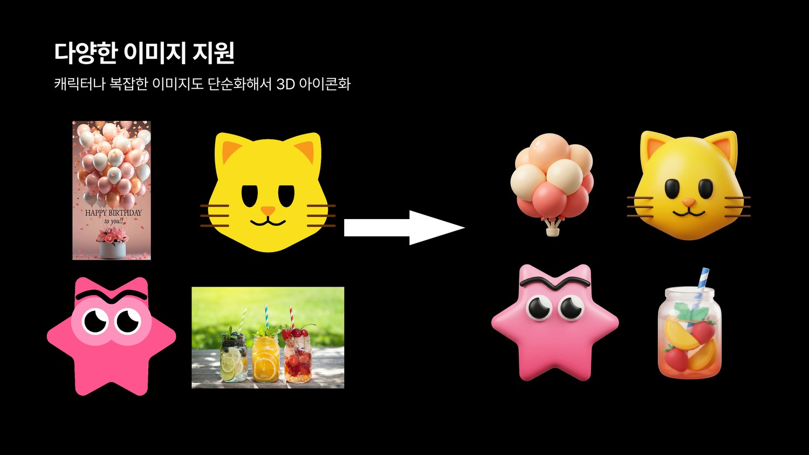
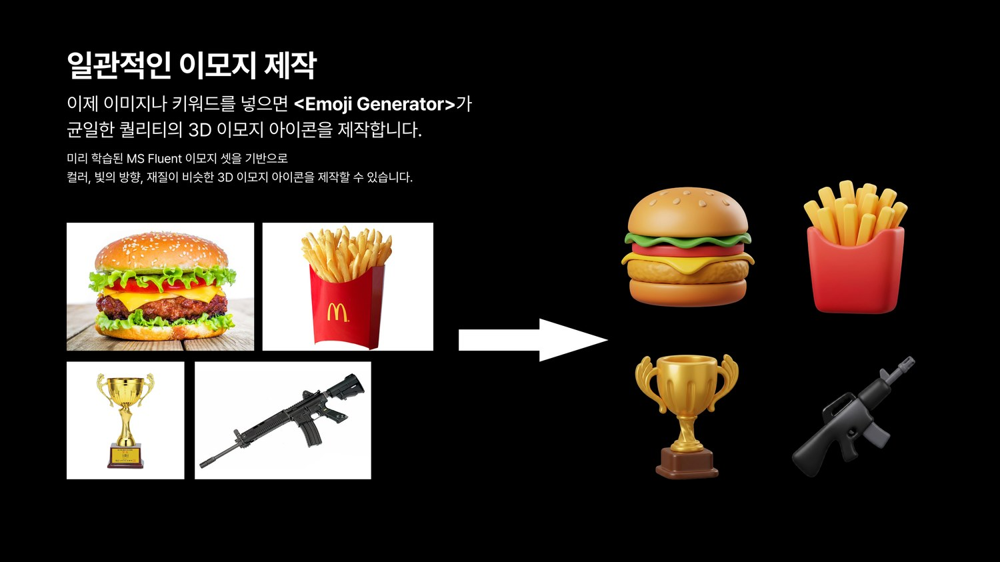
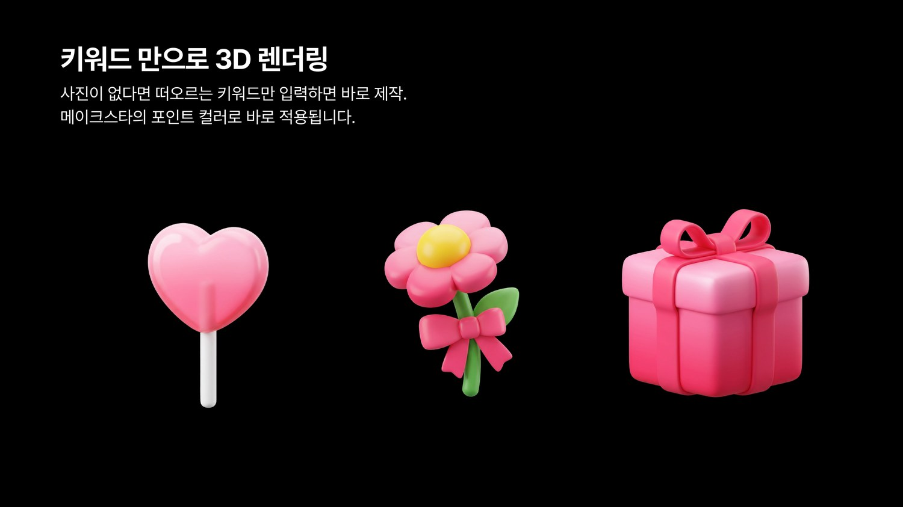

키워드나 이미지를 넣으면 Fluent 3D 스타일의 이모지를 생성하는 도구입니다. 생성 자체보다 **같은 스타일로 계속 뽑아내는 것**이 목표였습니다.

---

## 왜 만들었나

업무로 만드는 디자인 에셋 중에 가장 손이 많이 가는 게 아이콘입니다. 쓰이는 자리에 비해 공수가 크고, 특히 3D 이모지 스타일은 레퍼런스마다 룩앤필이 제각각이라 매번 다시 감을 잡아야 합니다.

한 개를 그럴듯하게 만드는 건 이제 어렵지 않습니다. 문제는 **두 번째부터**입니다. 같은 프롬프트를 다시 넣어도 조명이 달라지고, 색 채도가 튀고, 어떤 건 외곽선이 생깁니다. 낱개로 보면 다 괜찮은데 나란히 놓으면 한 세트가 아닙니다. 이모지는 하나만 쓰는 물건이 아니라서, 세트로 안 보이면 쓸 수가 없습니다.

---

## 무엇을 만들었나

**키워드 또는 이미지로 생성합니다.** 이미지를 첨부하면 그게 주 입력이 되고, 키워드는 선택입니다.

Gemini와 DALL·E 3 중에서 생성 모델을 고를 수 있습니다. 개인 API 키를 등록하면 브라우저에서 직접 호출하고, 개인 키가 없을 때는 서버 키를 설정한 환경에서 서버가 생성을 맡습니다.

사진뿐 아니라 캐릭터나 복잡한 이미지도 받습니다. 그대로 옮기는 게 아니라 **단순화해서** 3D 아이콘으로 만듭니다.

---

## 판단이 필요했던 순간들

### 1. 두 번째 이모지도 첫 번째와 같은 세트처럼 보이게 하려면?

같은 프롬프트로 뽑은 아이콘을 나란히 놓고 보면 차이가 보입니다. 하나는 왼쪽 위에서 빛을 받는데 다른 하나는 정면이 밝고, 같은 크기의 캔버스에 넣어도 어떤 아이콘은 유난히 작아 보입니다.

Fluent 3D 레퍼런스 200장을 보며 조명이 어디서 오는지, 화면을 얼마나 채우는지부터 살폈습니다. 조건을 바꿔 생성한 결과를 비교한 뒤, 빛은 왼쪽 위에서 부드럽게 들어오고 대상은 정사각형 캔버스의 86~88%를 채우도록 프롬프트에 적었습니다. 유리와 금속은 원래 색을 살리고, 광택이 있는 부분에만 흰빛이 또렷하게 맺히도록 했습니다.

브랜드 색은 리본이나 손잡이처럼 작은 부분에 넣었습니다. 포인트 색을 적용하는 게 기본이지만, 원래 색이 중요한 아이콘을 만들 때는 끌 수 있습니다.

### 2. 레퍼런스 200개를 직접 라벨링한 것

참조 이미지를 붙이면 결과가 좋아집니다. 문제는 어떤 참조를 붙일지 매번 사람이 찾아야 한다는 것입니다.

그래서 200개 레퍼런스에 **키워드·카테고리·형태·무드·색·표시 라벨**을 손으로 달았습니다. 이제 키워드를 넣으면 이 축들로 검색해 후보를 찾고, 최대 세 개를 캔버스에 합성해 참조로 넘깁니다. 파일명 검색으로는 "둥글고 말랑한 느낌"이나 "따뜻한 색 계열" 같은 조건을 걸 수 없습니다. 검색이 필요한 축을 미리 정해서 데이터에 심어두는 일 — 지루하지만 이 도구에서 가장 품이 든 부분이고, 결과 품질에 제일 크게 기여했습니다.

### 3. 참조와 복제 사이에 선을 그은 것

이미지를 첨부하면 그것을 그대로 흉내 내는 결과가 나올 수 있습니다. 남의 사진이나 브랜드 이미지를 넣으면 문제가 됩니다.

그래서 첨부 이미지를 바로 넘기지 않고 **두 단계로 처리**합니다. 먼저 분석해서 구조화된 설명만 뽑고, 그 설명을 생성 프롬프트에 붙입니다. 분석이 추출하는 것은 세 가지뿐입니다 — 대상의 형태와 범주, 대략의 포즈와 방향과 구도, 주요 색 팔레트. 그리고 사진의 디테일·배경·글자·로고·브랜드 마크는 따라 하지 말라고 명시합니다. 참조는 "이런 형태와 색"까지고, 그 너머는 복제입니다. 그 선을 도구가 대신 그어줍니다.

### 4. 특정 모델에 갇히지 않게 탈출구를 둔 것

처음엔 한 모델에 고정했습니다. 선택지를 주면 조합마다 결과가 달라져 비교가 무의미해지기 때문입니다. 지금은 Gemini와 DALL·E 3 두 갈래를 두되, **같은 렌더링 표준을 양쪽에 똑같이 먹입니다.**

초기 프로토타입에는 **모델에 종속되지 않는 프롬프트를 복사해 나가는 경로**도 있었습니다. 아무 콘솔에나 붙여 생성하고 결과 이미지를 다시 올리면 같은 메타데이터로 쌓입니다. 도구가 기대는 모델은 언젠가 바뀌거나 없어집니다. 그때 라이브러리와 스타일 규칙까지 같이 버리게 되면 그동안 쌓은 게 사라집니다. 모델은 부품이고, 축적되는 건 규칙과 결과물이어야 합니다.

---

## AI가 한 것 / 내가 한 것

**AI가 잘한 것.** 두 단계 분석 파이프라인, 레퍼런스 검색과 캔버스 합성, 라이브러리 저장과 동기화, 상태 필터, 설정 패널. 프로바이더를 하나 더 붙일 때도 기존 경로를 건드리지 않고 갈래만 늘려줬습니다.

**넘길 수 없었던 것.** 렌더링 표준입니다. 명도 0.82~0.92라는 숫자는 모델이 알려주지 않습니다. 200장을 보고 "이 세트가 공유하는 게 뭐지"를 뽑아낸 다음, 그걸 모델이 알아들을 문장으로 번역하는 일입니다. 디자이너가 하던 스타일 가이드 작성과 정확히 같은 작업이고, 다만 독자가 사람에서 모델로 바뀌었습니다.

레퍼런스 라벨링도 그렇습니다. 어떤 축으로 검색할지를 정하는 건 이 도구를 무엇에 쓸지 아는 사람만 할 수 있습니다. AI에게 "라벨을 달아줘"라고 하면 달아주지만, 무엇을 축으로 삼을지는 먼저 정해줘야 합니다.
